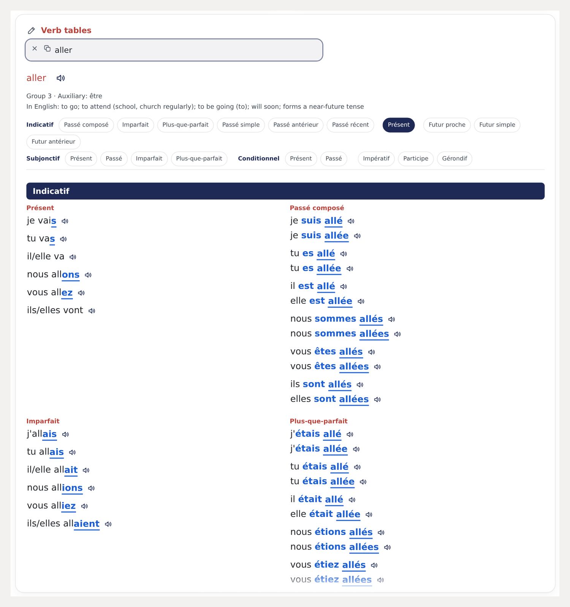
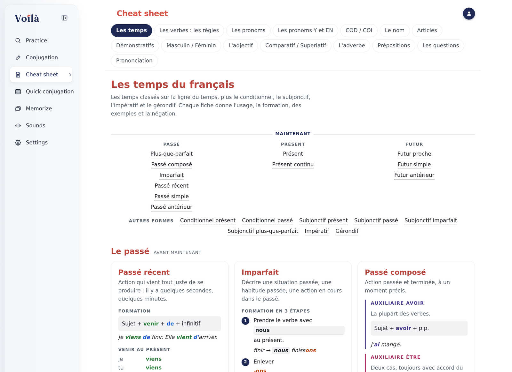
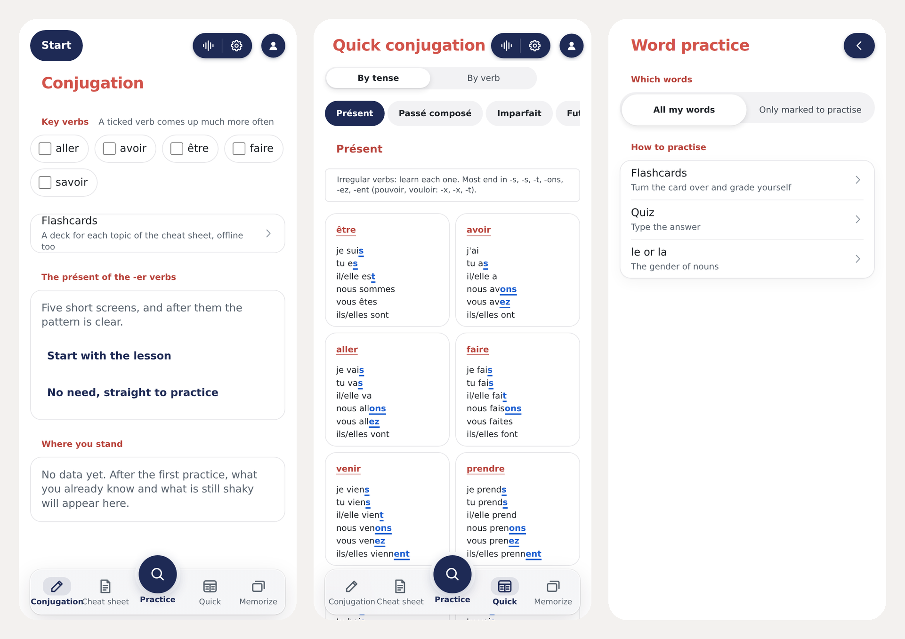

<h1 align="center">Voilà</h1>

<b>A French practice app that remembers what you get wrong.</b>

> **This is a showcase.** The source code is private, because Voilà is built around one person's progress. Here is what it does and why I trust it.

Voilà is the app I use to practise French, on my phone and my laptop. It starts with conjugation: 17 tenses and about 7,800 verbs. Around that sit a cheat sheet, vocabulary practice, reading rules and sounds, and a coach that follows my progress. The interface is in English, with a full Hebrew toggle. French is always the content.

Every exercise is made and checked on the device itself, so it answers instantly and works on a plane. No AI decides, while I practise, what a verb should look like.

## It keeps track of what is shaky

Practice follows each verb, tense and person separately. What I get wrong comes back, and what I know well gets out of the way. A screen called "Where you stand" shows what is solid and what is still shaky. I can also tick the five key verbs I want to master, and they come up far more often.

## Checked before you see it

In this project, a bug in the game is tolerable, and an error in the French is not. So Voilà is built like something that cannot afford to be wrong:

- **Twelve checks** run before anything reaches the app.
- **Hundreds of deliberately wrong French examples** prove that those checks refuse what they should.
- **Every release is sealed.** It carries a fingerprint of every byte, and the app refuses to start from one that was changed afterwards.
- **An interrupted update changes nothing.** The previous version keeps running until the new one is complete.

## What is inside

- **Conjugation across 17 tenses and 4 moods,** with verbs grouped into 7 families and 74 sub-families, so I learn the pattern and not only the list. Nothing is locked.
- **A full cheat sheet** for every French tense, and quick tables for the most common irregular verbs.
- **Verb tables:** type any verb and see it in every tense.
- **Short lessons** that teach first and then practise.
- **Reading rules and sounds,** decks of sentences to learn by heart, and word practice for vocabulary.
- **An explanation for every answer.**

## A look

Real screens of the app, captured on a fresh install with an empty database, so they show no personal data.

**On the computer:** the verb tables in Practice, where I type any verb and see it in every tense, and the cheat sheet, a reference for every French tense with its use, its formation and examples.

**On the phone:** the conjugation setup, quick conjugation, and word practice for vocabulary.

## A coach inside the app

A French coach, a separate AI agent, writes my learning plan and reports on how I am doing. They appear in a personal area in the app, behind the profile circle on every screen: progress by level, the road to an exam, and more.

The coach and the app agree on a written format, so only well-formed reports ever show up. The area is private to me, and the last copy is kept on my phone, so it opens even without a signal.

## How I built it

With a team of AI agents: one plans, others build, one tests, one reviews security, one ships. I am the human in the loop who decides. Every release leaves a dated restore point behind.

## Want to see it work?

The code stays private, but I am happy to show you Voilà live.

Built by <a href="https://github.com/einavtayari">Einav</a>, the human in the loop.

