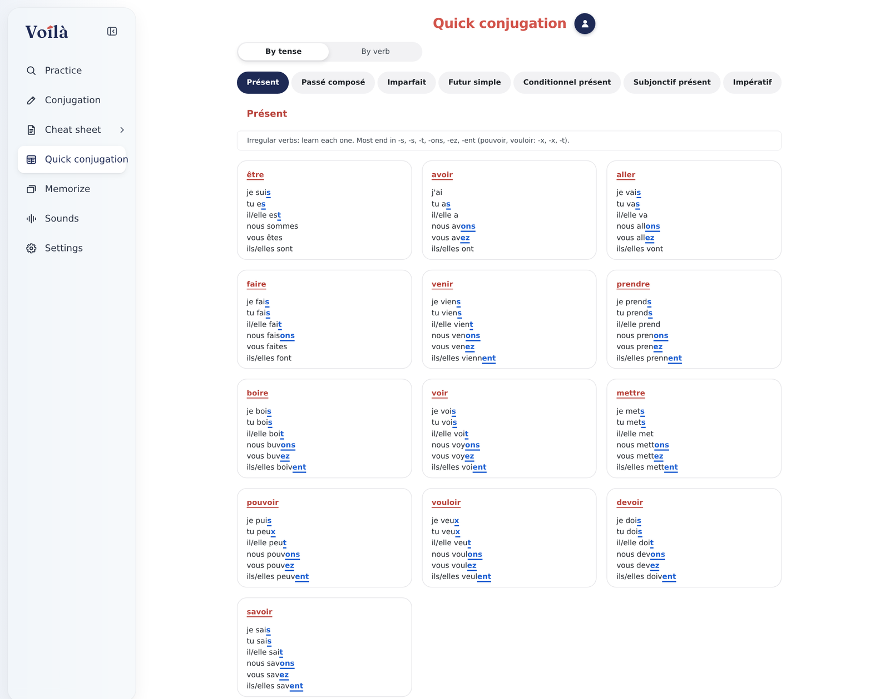
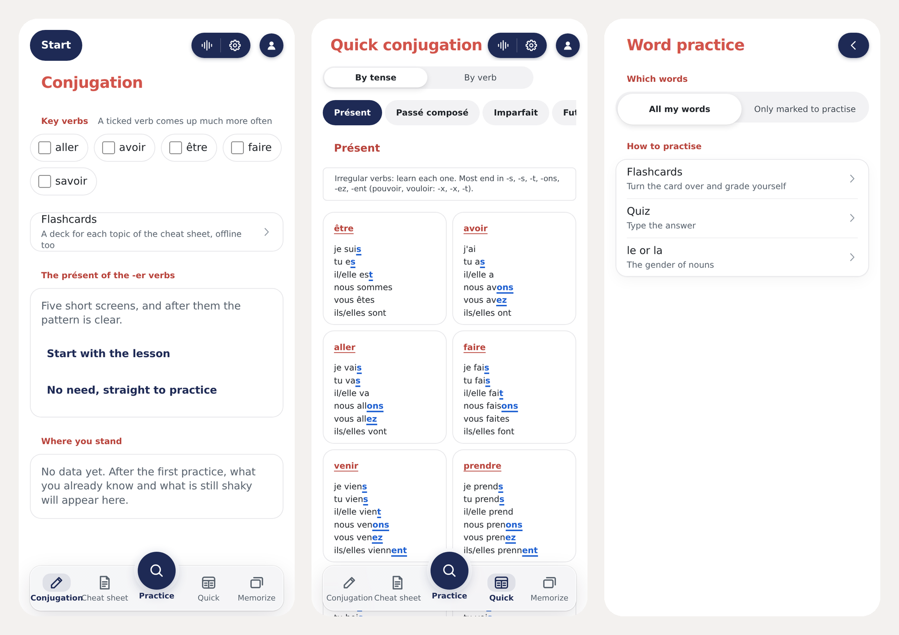
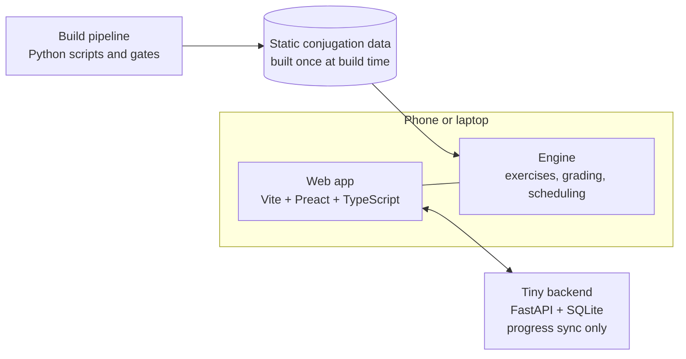

# Voilà

> **This is a showcase. The source code is private.**
> It is a personal learning tool built around one person's progress data, so the code and the data stay private. This page explains what I built and why it is built the way it is.

Voilà is an app for practising French verb conjugation. It is an installable web app that runs on a phone and a laptop, served from a single machine on a private network. The interface is English by default, with a full Hebrew toggle. French is always the content, never the chrome.

## The idea

- **Everything happens on the device.** Every exercise is generated and graded locally, against a conjugation dataset that is built once, at build time, and shipped as static data. The app needs no network to teach and makes no AI call at runtime. There is no API key anywhere in the project.
- **A bug in the game is tolerable. An error in the grammar is not.** Almost everything unusual about this project exists because of that one sentence.

## A look

Real screens of the app, captured on a fresh install with an empty database, so they show no personal data.

**On the computer:** the cheat sheet, a reference for every French tense with its use, its formation and examples, and the quick conjugation tables for the most common irregular verbs.

**On the phone:** the conjugation setup, quick conjugation, and word practice for vocabulary.

## A coach that is part of the app

Voilà is connected to a French coach, a separate AI agent that writes my learning plan and reports on how I am doing, and those show up inside the app.

- **A personal area in the app.** A profile circle on every screen opens my learning plan and the coach's reports, for example progress by level or the road to an exam.
- **A written contract between the coach and the app.** The coach writes its files in an agreed format. If a file follows the contract, the app shows it. If not, a sync script refuses it before it ever reaches the repository.
- **Private by construction.** Only the owner's account can read it, nothing is cached publicly, and the last good copy is kept on the device so it still opens without a signal.
- **The coach learns as I do.** The plan and the reports are updated as I progress, so what I see is the coach's current view of me and not a fixed syllabus.

## What it does

- **Conjugation practice** across 17 tenses in 4 moods, over a dictionary of about 7,800 verbs. Nothing is locked: the level shown on a tense is a hint, never a gate.
- **Verb families.** Verbs are classified into 7 pattern families and 74 sub-families, so practice can follow the pattern instead of the list.
- **An exercise ladder.** Exercises come in shapes of increasing difficulty, and a session climbs them.
- **Spaced repetition** (SM-2) tracked per verb, tense and person, with a promotion window kept per family so it fills quickly enough to be useful.
- **Key verbs.** Five checkable verbs that come up far more often until I untick them.
- **A rules-of-reading mode**, a cheat sheet, short teach-first lessons, decks of sentences to memorise, and a quick-conjugation view.
- **Honest feedback.** Every answer is explained in the interface language.

## How it is put together

The backend is deliberately tiny: it stores progress so the phone and the laptop stay in sync, and it serves the web build. Sign-in is by Google, with an allowlist of two people.

## The part I am most proud of: a verification stack

Because grammar errors are not acceptable, releases are treated like a safety-critical process.

- **Twelve blocking deploy gates.** Eleven run before the build, and one checks the size of the build itself.
- **A negative-test harness** of several hundred cases that deliberately feeds the gates wrong French to prove they refuse it.
- **Immutable, stamped releases.** A release is built once, carries a hash over every byte, and is verified again by the service at start-up. A release that is missing, unstamped or edited is refused with a clear page.
- **Atomic publishing.** An interrupted publish leaves the previous release serving.
- **No back doors.** The service reads content only from a verified release, never from the working copy. This rule was added after an agent noticed an unexpected change in the running app and reported it, instead of moving on: one file had been reaching the live app with no gate in between.

## How it is built

With a team of AI agents: a main conductor session hands work to specialist agents (planning, building, QA, security, documentation, deployment), and every release leaves a dated restore point behind. The app itself makes no AI calls when it teaches.

## Stack

Vite, Preact, TypeScript, Python, FastAPI, SQLite, a PWA service worker, systemd, Tailscale, Claude Code.

## Status

In daily use. Screenshots are not included here because the app shows personal progress data.
